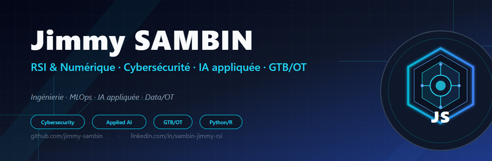
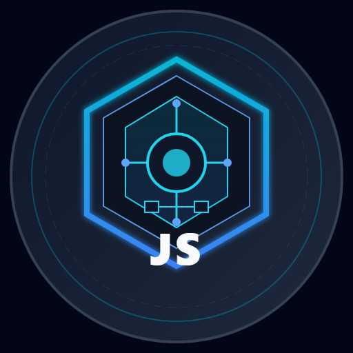

  

  

  
  

## 👋 Bonjour, je suis Jimmy Sambin

Ingénieur, je conjugue **systèmes d'information**, **cybersécurité**, **intelligence artificielle appliquée** et **opération technologique** (GTB/BACnet/KNX/OT).

Passionné par la fiabilité des infrastructures critiques, j'aime transformer les données opérationnelles en décisions actionnables — de la maintenance prédictive CVC à la supervision des bâtiments intelligents.

---

## 🛠️ Expertise

- **Cybersécurité** : posture de sécurité, durcissement, veille, gouvernance NIS2
- **IA appliquée** : Machine Learning, RAG, agents IA, LLM locaux/cloud, analyse prédictive
- **GTB / OT** : BACnet, KNX, supervision technique des bâtiments, infrastructures critiques
- **Data & Automation** : Python, R, SQL, n8n, Qdrant, scripts d'indexation et pipelines ETL
- **Maths & Modélisation** : Maple, MATLAB, Mathematica

---

## 📌 Projets

| Projet | Description | Langage / Stack |
|--------|-------------|-----------------|
| [<strong>ML-PANNES-CVC</strong>](https://github.com/jimmy-sambin/ML-PANNES-CVC) | Prédiction des pannes CVC par moteur d'apprentissage Random Forest | Python, scikit-learn, pandas |
| [<strong>SOC-AUTONOME-DEEPAGENTS</strong>](https://github.com/jimmy-sambin/SOC-AUTONOME-DEEPAGENTS) | SOC autonome multi-agents : triage, investigation, corrélation et réponse assistée par IA | Python, LangGraph, DeepAgents, n8n |
| [<strong>ML-CHURN-TELCO</strong>](https://github.com/jimmy-sambin/ML-CHURN-TELCO) | Prediction du churn client telecom (dataset IBM Telco, Kaggle 2023) par moteur XGBoost - accuracy 75,1 %, AUC 0,835 | Python, pandas, scikit-learn, XGBoost |

*<i>D'autres projets autour du RAG, de la cybersécurité et de la supervision GTB arrivent prochainement.</i>*

---

## 📊 Statistiques GitHub

  
  

---

## 🎯 En ce moment

- 🔭 Construction de collections RAG locales et cloud (Qdrant, n8n, agents multi-modèles)
- 🌱 Veille continue sur la cybersécurité post-quantique et les standards IA (NIST, ANSSI)
- 💬 Ouvert aux échanges sur les sujets **cybersécurité**, **IA appliquée**, **GTB/OT** et **maintenance prédictive**

---

## 📫 Me contacter

- 💼 [LinkedIn](https://www.linkedin.com/in/sambin-jimmy-rsi)
- 🐙 [GitHub](https://github.com/jimmy-sambin)
- 📧 [j.sambin@gmail.com](mailto:j.sambin@gmail.com)

---

  

